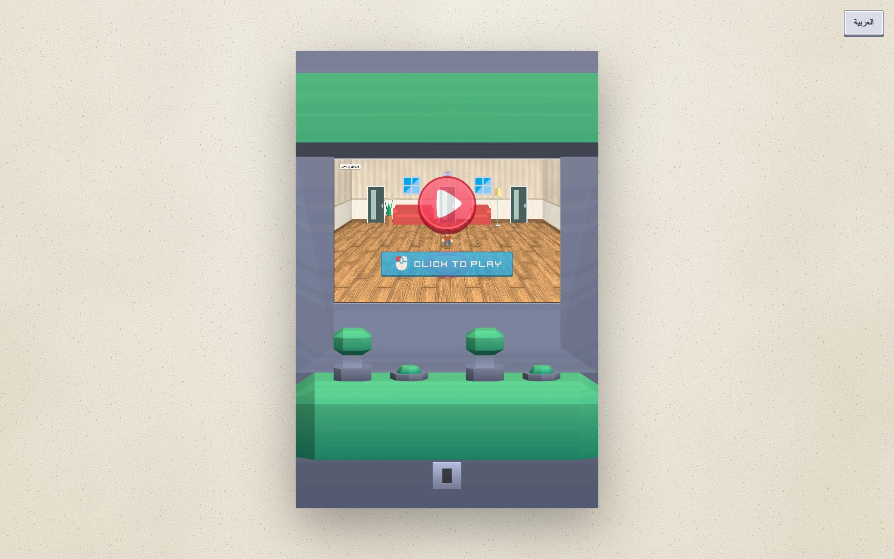
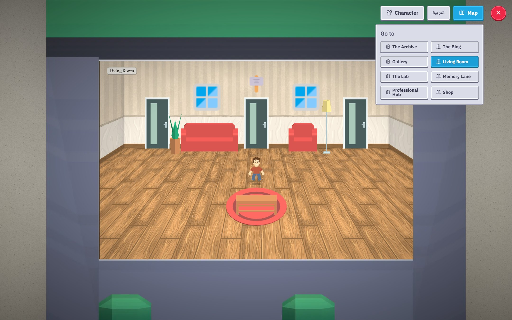
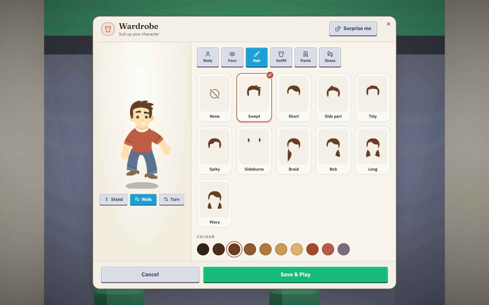

# Creatofolio

**A portfolio you draw yourself and visitors can walk around in.**

Creatofolio is a self-hostable website builder for artists and other creative
people. Instead of picking a template, you draw your site: a landing page made
of your own illustrations, and a small click-to-walk game world where every
object can open a pop-up, a project, a video or a door to another room.
Everything is edited in the browser, in English and Arabic, on a desktop or an
iPad with a Pencil.

It began as one person's portfolio and is released as-is under the MIT
licence for anyone to use, fork and reshape.

> **Project status:** feature-complete for a single-owner site, but not
> actively developed by its original author. There is no automated test suite.
> Issues and pull requests are welcome; see [CONTRIBUTING.md](CONTRIBUTING.md).



| | |
| --- | --- |
|  |  |

Everything in these pictures is starter content: the art comes from open
packs ([credits](THIRD_PARTY_NOTICES.md)) and is there to be replaced with
your own drawings.

## What's in it

**For visitors**

- **A walkable world.** Rooms rendered with Phaser 3: click-to-walk, depth
  sorting, doors between rooms, a mini-map, a customisable avatar, hover
  effects, Easter eggs and character dialogue with choices.
- **A drawn landing page.** Sections built from positioned drawings and
  content blocks, an "arcade cabinet" hero that zooms into the game, sub-pages,
  navigation, forms, SEO and share cards.
- **Pop-ups.** One accessible pop-up system for both: rich text, galleries,
  video, audio, CV timelines, project cards, downloads, contact forms, tabs,
  accordions and magazine-style pages, in themes and frames you draw.
- **English and Arabic** throughout, with full right-to-left layouts.
- **A loading screen** with six animated presets you can redraw.

**For the owner (`/admin`)**

- **Room editor** (Konva): place, resize, rotate and layer objects, draw walk
  areas, wire doors, build click and walk-near step sequences, undo/redo.
- **World map:** arrange rooms spatially, keep several worlds, choose which is
  live.
- **Landing page editor:** a visual CMS with page versions, drafts and
  publish, per-device layouts, a navigation studio and site settings.
- **Drawing studio:** an embedded, patched [Klecks](https://github.com/bitbof/klecks)
  with layers, guide layers that never export, autosave and pencil-only mode.
- **Drafts and Publish** for rooms too, with history, a "play the draft"
  preview, a trash with restore, and conflict detection between tabs.
- **Wardrobe, pop-up styles, loading screen, storage clean-up and security**
  (two-factor sign-in) pages.
- **Touch mode:** the whole admin works on an iPad, with pinch zoom,
  long-press menus and 44 px targets.

## How it's built

| | |
| --- | --- |
| App | Next.js 16 (App Router), React 19, TypeScript, Tailwind CSS 4 |
| Game | Phaser 3 |
| Editors | Konva / react-konva, Moveable, TipTap, Zustand + zundo |
| Drawing | Klecks (cloned at a pinned commit and patched at install time) |
| Backend | Supabase: Postgres with Row Level Security, Auth, Storage |

[docs/ARCHITECTURE.md](docs/ARCHITECTURE.md) is the detailed tour.

```
app/                  the Next.js application (run npm commands here)
supabase/migrations/  SQL migrations: the whole database, from empty
docs/                 architecture, ops runbooks, editor notes
```

## Quick start

You need **Node.js 20.9 or newer** and **git**.

### 1. Run it without a database

```bash
git clone https://github.com/HussainAlmukhtar/creatofolio.git
cd creatofolio/app
npm install
npm run dev
```

Open <http://localhost:3000>. With no Supabase credentials the public site
runs from the built-in demo content in `app/src/data/`. The admin area stays
closed until you finish the steps below.

`npm install` also builds the drawing studio: it clones Klecks at a pinned
commit into `klecks/`, applies the patches in `app/scripts/klecks-patches/`
and builds it into `app/public/klecks/`. This needs network access and takes
a few minutes the first time. (The fonts are fetched from Google Fonts when
the app builds, so that needs network access too.)

### 2. Create a Supabase project

Either a project on [supabase.com](https://supabase.com) or a
[self-hosted](https://supabase.com/docs/guides/self-hosting) instance.

Apply the migrations in `supabase/migrations/`. With the
[Supabase CLI](https://supabase.com/docs/guides/local-development), from the
repository root:

```bash
supabase login
supabase link --project-ref <your-project-ref>
supabase db push
```

`link` asks for the database password you chose when you created the
project. If the CLI asks for a config file, run `supabase init` first and
keep the existing `supabase/migrations` folder.

Without the CLI, paste each file into the SQL editor **in filename order**.
The migrations create every table, function, policy and storage bucket, and
are safe to apply to a new, empty project in one go.

### 3. Create the owner account

Creatofolio has exactly one editor: the owner.

1. In the Supabase dashboard, **Authentication → Users → Add user**: your
   email and a strong password. Tick **Auto Confirm User**, or sign-in will
   fail with "Email not confirmed".
2. In the SQL editor, tell the database who the owner is:

   ```sql
   INSERT INTO public.app_owner (email) VALUES ('you@example.com');
   ```

3. **Close sign-ups** (Authentication settings; on self-hosted GoTrue,
   `DISABLE_SIGNUP=true`). Nobody else needs an account.

### 4. Configure the app

```bash
cd app
cp .env.example .env.local
```

Fill in `.env.local`. On supabase.com the URL and both keys are under
**Project Settings → API**; on a self-hosted instance they are in its own
environment file.

| Variable | What it is |
| --- | --- |
| `NEXT_PUBLIC_SUPABASE_URL` | Your project's API URL |
| `NEXT_PUBLIC_SUPABASE_ANON_KEY` | The public anon key |
| `SUPABASE_SERVICE_ROLE_KEY` | The service-role key. **Server-only secret.** |
| `OWNER_EMAIL` | The same address you put in `app_owner` |
| `NEXT_PUBLIC_SITE_URL` | Your site's public origin (for the sitemap and share cards) |

The remaining variables are optional and explained in
[`app/.env.example`](app/.env.example).

### 5. Seed the demo world (optional)

```bash
npm run db:seed
```

This copies the demo rooms and pop-ups into your database and creates the
`main` world, so you have something to edit. Skip it to start from an empty
world map.

It is safe to run again: it only adds what is missing and never overwrites a
room or pop-up you have edited. To throw your changes to the starter rooms
away and start over from the built-in versions, run `npm run db:seed:reset`.

### 6. Sign in

Restart `npm run dev`, open <http://localhost:3000/admin/login> and sign in.
Then visit **/admin/security** and enrol two-factor on two devices: there are
no recovery codes, and recovery is a server-side job
([docs/ops/ACCOUNT_RECOVERY.md](docs/ops/ACCOUNT_RECOVERY.md)).

## Making it yours

[docs/GUIDE.md](docs/GUIDE.md) is the owner's handbook: how to use each
editor, step by step.

Everything a visitor sees is starter content meant to be replaced, mostly
from the admin pages rather than in code:

- **Rooms, objects, pop-ups:** `/admin/editor` and the World map.
- **Landing page, navigation, fonts, SEO:** `/admin/landing-editor`.
- **Avatar art:** `/admin/wardrobe`. Upload a PNG, or draw a piece in the
  built-in studio over a faint guide of the starter body. Visitors dress
  their own character with the **Character** button in the game; the starter
  wardrobe has skin tones, faces, hair, tops, bottoms and shoes, all
  recolourable.
- **Built-in buttons:** the game's buttons use the art in `app/public/ui/`
  and one block of CSS (`.kui-btn` in `app/src/app/globals.css`). The
  language, map and close buttons can also be replaced with your own
  drawings from the arcade section of the landing editor.
- **Pop-up themes and frames:** `/admin/popup-styles`.
- **Loading screen:** `/admin/loading-screen`.
- **Site name and default metadata in code:** `app/src/lib/landingMetadata.ts`,
  `app/src/app/layout.tsx`, `app/src/app/manifest.ts`, and the icons in
  `app/src/app/`.

## Deploying

Creatofolio is a standard Next.js app with a Node server (`npm run build`,
`npm run start`), so it runs on Vercel, in a container, or on any Node host.

- Set the same environment variables as in `.env.local` on the host.
- The build needs `git` and network access (for the Klecks step and the
  fonts).
- `next.config.ts` must be able to load images from your Supabase/Storage
  host; it derives the allowed hosts from the environment variables.
- Optional: serve uploads straight from a bucket or CDN with
  `NEXT_PUBLIC_STORAGE_PUBLIC_URL`.

## Security model, in short

- `/admin/*` admits only the owner (`src/proxy.ts`), and requires a
  two-factor code once a factor is enrolled.
- Keep Next.js up to date: the admin gate runs in its proxy layer, so its
  security releases matter here. `npm audit` should report nothing.
- Every write API route checks the owner again; the proxy does not cover
  `/api/*`.
- The database enforces it independently: Row Level Security lets anyone read
  published content and lets only the owner write, via `public.is_owner()`.
- Content URLs and embeds go through allowlists.

Found a problem? See [SECURITY.md](SECURITY.md).

## Contributing

Read [CONTRIBUTING.md](CONTRIBUTING.md) and the
[Code of Conduct](CODE_OF_CONDUCT.md). Coding agents: start with
[CLAUDE.md](CLAUDE.md).

## Credits

Creatofolio stands on a lot of open-source work, above all
[Klecks](https://github.com/bitbof/klecks) (the drawing studio),
[Phaser](https://phaser.io), [Konva](https://konvajs.org),
[Next.js](https://nextjs.org) and [Supabase](https://supabase.com), with
editor ideas borrowed from [LDtk](https://ldtk.io). The starter character,
character-creator wardrobe, room furniture, arcade machine and buttons are from
[Kenney](https://kenney.nl)'s CC0 asset packs; the small room objects are
Microsoft's MIT-licensed [Fluent Emoji](https://github.com/microsoft/fluentui-emoji);
the room walls and floors are CC0 textures by OzMaister and PamNawi from
[OpenGameArt](https://opengameart.org). The full list and
licences are in [THIRD_PARTY_NOTICES.md](THIRD_PARTY_NOTICES.md).

## Licence

[MIT](LICENSE) for the code. The starter art is from open packs (Kenney and OpenGameArt
textures, CC0; Fluent Emoji, MIT); details in
[THIRD_PARTY_NOTICES.md](THIRD_PARTY_NOTICES.md).
